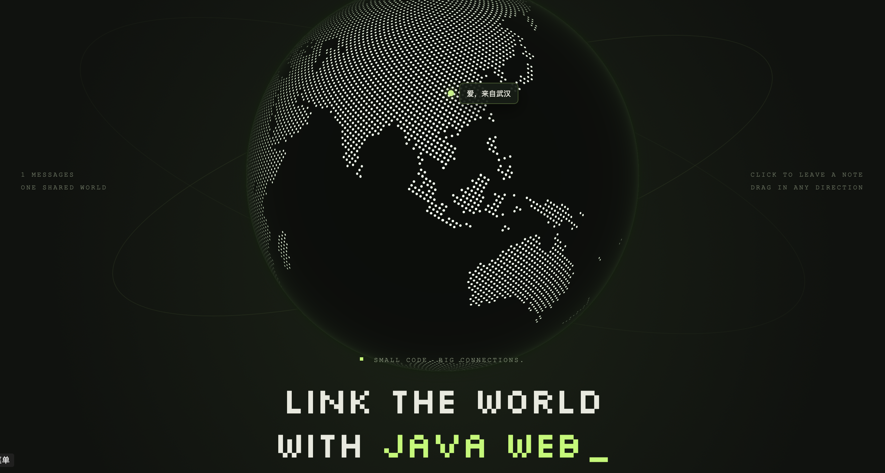
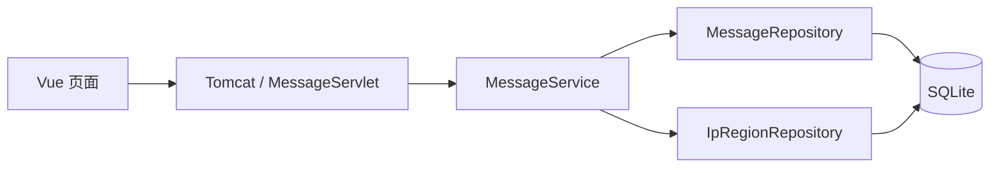

# Java Web · Link the world

在地球上选一个位置，留下一段文字，与下一位访客开始对话。

## 项目介绍

一个交互地球留言板，使用 Vue 3 和 COBE 展示地球，通过 Java Servlet 接收请求，将留言保存到 SQLite。Maven 统一组织前后端构建，生成可部署到 Tomcat 的 WAR。

| 部分 | 技术 |
| --- | --- |
| 页面与交互 | Vue 3、TypeScript、COBE、Vite |
| HTTP 服务 | Jakarta Servlet 6、Tomcat 10.1 |
| 数据存储 | SQLite、SQLite JDBC |
| IP 国家／地区查询 | DB-IP Country Lite 离线数据 |
| 构建 | Maven 调用 npm 构建前端并打包 WAR |

当前实现尚未完成构建、运行和联调验证。

## 功能与交互

### 在地球上留言

1. 向任意方向拖动或使用触控板滚动地球，也可用键盘四个方向键旋转。
2. 点击可见球面上的任意位置，包括海洋；键盘回车可选择球心位置。
3. 地球通过非线性缓动旋转、放大至选中位置，显示输入面板。
4. 输入文字，点击勾选 SVG 按钮发布。

鼠标悬停在球面时，自转逐渐减速；移开后逐渐恢复。编辑期间保持暂停，并尊重系统的减少动态效果偏好。

### 阅读与管理留言

- 打开网页后自动加载留言，在对应经纬度显示标记。
- 球面正面的标记直接显示留言摘要；悬停可预览全文，点击打开编辑面板。地球下方列出全部留言，背面的留言也可找到。
- 编辑已有留言时，停止输入 900ms 后自动保存，也可以手动保存。
- 删除前在面板内确认。
- 保存失败保留输入；多人编辑产生版本冲突时，提示重新载入。

项目不设登录和作者权限，**所有访客都可以编辑、删除任何留言**。发布时由后端记录请求 IP，页面仅展示解析出的国家／地区，不公开原始 IP。留言坐标由用户点击决定，与 IP 所在地无关。

## 快速开始

### 环境要求

| 工具 | 要求 |
| --- | --- |
| Java | JDK 17 或更高版本 |
| Maven | 3.9 或更高版本 |
| Tomcat | 10.1.x，对应 Jakarta Servlet 6 |
| Node.js | `^22.18.0` 或 `>=24.12.0` |
| npm | 已安装且在 PATH 中可用 |

Tomcat 9 使用的 `javax.servlet` 与本项目的 `jakarta.servlet` 不兼容。在 IDEA 中可直接打开根目录并导入 `pom.xml`。

### 在 IDEA 中直接启动

根目录 `package.json` 已提供完整启动入口，无需先安装 npm 根目录依赖或手动安装 Tomcat。

1. 重新打开项目，让 IDEA 加载 Maven 配置；若尚未关联，在 Maven 工具窗口点击 **Link Maven Projects** 并选择根目录 `pom.xml`。
2. 在运行配置中选择 **Java Web**，或点击根目录 `package.json` 中 `start` 旁的运行按钮。
3. 等待构建、Tomcat 启动及离线库导入，然后访问 `http://127.0.0.1:8080/java-web-classwork/`。

IDEA 启动进程的 PATH 中需要有 `mvn`、`java` 和 `npm`。首次运行需要联网下载 Maven 依赖与 Tomcat 10.1.60。

| 根目录命令 | 行为 |
| --- | --- |
| `npm start` | Maven 构建前后端、自动准备 Tomcat、部署并持续运行 |
| `npm run dev` | 与 `npm start` 相同，兼容原有 IDEA npm dev 配置 |
| `npm run stop` | 停止该项目的 Tomcat |
| `npm run build` | 仅打包 WAR |
| `npm run dev:frontend` | 单独启动 Vite 热更新服务，需先启动后端 |

完整启动模式由 Tomcat 同时提供页面和 API；修改代码后重新启动生效。需要前端热更新时，在后端已启动的情况下另开 `dev:frontend`，访问 Vite 输出的地址。
启动和打包命令跳过测试，但会执行编译及现有前端类型检查。停止可用运行面板的停止按钮或 `npm run stop`，不要同时运行多个完整启动实例占用 8080 端口。

通过这些命令启动时，数据库保存在项目根目录的 `data/messages.sqlite`，独立于 `target/` 和 Tomcat 临时配置，避免清理构建产物时丢失数据。`JAVA_WEB_DATA_DIR` 仍可覆盖该路径。

### 手动获取并打包

```sh
git clone https://github.com/superwfox/java-web-classwork.git
cd java-web-classwork
mvn clean package
```

Maven 依次执行前端依赖安装、前端构建（包含 TypeScript 检查）和 WAR 打包，生成：

```text
target/java-web-classwork.war
```

### 部署到 Tomcat

将 WAR 复制到 Tomcat 的 `webapps/` 目录，启动 Tomcat，然后访问：

```text
http://127.0.0.1:8080/java-web-classwork/
```

首次启动会自动建表，并将离线国家数据导入 SQLite；导入完成后留言 API 才可用。前端资源和 API 使用相对应用路径，支持 WAR 上下文路径部署。

## 项目结构与职责

代码按业务对象组织，留言功能集中在 `message/`，共享数据库和地域查询各自独立。

```text
java-web-classwork/
├── pom.xml
├── frontend/
│   ├── package.json
│   ├── vite.config.ts
│   └── src/
│       ├── App.vue
│       ├── components/MessageGlobe.vue
│       └── message/api.ts
├── src/main/
│   ├── java/com/example/javaweb/
│   │   ├── message/
│   │   │   ├── Message.java
│   │   │   ├── MessageServlet.java
│   │   │   ├── MessageService.java
│   │   │   └── MessageRepository.java
│   │   ├── geo/IpRegionRepository.java
│   │   └── database/Database.java
│   └── resources/
│       ├── db/schema.sql
│       └── geo/
└── docs/images/hero.png
```

| 文件 | 职责 |
| --- | --- |
| `App.vue` | 留言面板、保存状态、编辑与删除交互 |
| `MessageGlobe.vue` | 地球动画、经纬度投影与反算、留言标记 |
| `message/api.ts` | 前端请求、留言类型、国家名称显示 |
| `MessageServlet` | HTTP 参数与响应、请求格式和大小限制 |
| `MessageService` | 文字与坐标校验、协调地域查询及留言操作 |
| `MessageRepository` | 留言 SQL、幂等创建、版本条件更新与删除 |
| `Message` | 对外返回的留言数据对象 |
| `IpRegionRepository` | 离线 IP 数据导入及国家查询 |
| `Database` | SQLite 连接、建表、WAL 与等待超时配置 |



## 数据与配置

### 留言数据

| 字段 | 含义 |
| --- | --- |
| `id` | 留言 ID |
| `text` | 纯文本，1–1000 个 UTF-16 代码单元 |
| `latitude` / `longitude` | 点击位置的纬度和经度 |
| `country` | 发布 IP 对应的国家／地区代码；未知时为空 |
| `createdAt` / `updatedAt` | UTC 时间，ISO 8601 格式 |
| `version` | 编辑和删除时使用的并发版本号 |
| `source_ip` | 原始发布 IP，仅存储在后端 |
| `request_id` | 创建请求幂等键，仅存储在后端 |

前端按纯文本渲染留言。经纬度范围分别为 `[-90, 90]` 和 `[-180, 180]`。

### SQLite 存储

默认数据库位置为：

```text
${catalina.base}/data/java-web-classwork/messages.sqlite
```

数据位于 WAR 外部，重新部署时保留。Tomcat 进程需要对该目录有写入权限。

| 环境变量 | 用途 | 默认行为 |
| --- | --- | --- |
| `JAVA_WEB_DATA_DIR` | 指定数据库所在目录 | 使用上述 Tomcat 数据目录 |
| `JAVA_WEB_GEO_FILE` | 指定离线国家库 CSV.GZ 的绝对路径 | 使用 WAR 内置快照 |

环境变量需配置到 **Tomcat 进程**。备份时停止 Tomcat，或使用 SQLite 在线备份；WAL 运行期间不能只复制主数据库文件。

### IP 与离线国家数据

后端从 `request.getRemoteAddr()` 取得 IP，不直接信任客户端提交的 IP 或 `X-Forwarded-For`。如果使用反向代理，应在 Tomcat 配置 RemoteIpValve，并仅信任实际代理地址，否则记录的是代理 IP。

国家查询支持 IPv4 和 IPv6，请求期间不访问外部定位 API。回环、内网或无法识别的地址显示“未知地域”，定位结果仅作近似参考。

更新离线库时，下载新的 Country Lite **CSV.GZ**，设置 `JAVA_WEB_GEO_FILE` 后重启 Tomcat。文件路径或修改时间变化会触发事务内重新导入；历史留言保留发布时的国家信息。数据来源及快照信息见 [geo/NOTICE.md](src/main/resources/geo/NOTICE.md)。

## API 说明

基址：`<应用上下文>/api/messages`。

### 查询留言

```http
GET /java-web-classwork/api/messages?after=0
```

每页最多 200 条，按 ID 升序排列。使用响应中的 `next` 作为下一次请求的 `after`，直到 `next` 为 `null`。

```json
{
  "items": [
    {
      "id": 1,
      "text": "Hello, world!",
      "latitude": 1.35,
      "longitude": 103.82,
      "country": "SG",
      "createdAt": "2026-09-28T08:00:00Z",
      "updatedAt": "2026-09-28T08:00:00Z",
      "version": 1
    }
  ],
  "next": null
}
```

### 创建、编辑与删除

统一使用 POST，表单编码为 `application/x-www-form-urlencoded`，请求头携带 `X-Requested-With: JavaWeb`。浏览器通过同源请求访问，服务端不开放跨域。

| 操作 | 表单参数 | 成功响应 |
| --- | --- | --- |
| `action=create` | `requestId`（UUID）、`text`、`latitude`、`longitude` | 201，留言对象 |
| `action=update` | `id`、`version`、`text` | 200，更新后的留言对象 |
| `action=delete` | `id`、`version` | 204，无响应体 |

创建示例：

```sh
curl 'http://127.0.0.1:8080/java-web-classwork/api/messages' \
  -H 'X-Requested-With: JavaWeb' \
  --data-urlencode 'action=create' \
  --data-urlencode 'requestId=78d16d70-711a-4a60-b2b0-ec7d194e844e' \
  --data-urlencode 'text=Hello, world!' \
  --data-urlencode 'latitude=1.35' \
  --data-urlencode 'longitude=103.82'
```

每条新留言使用新的 UUID；重试同一次创建请求时复用原 UUID，避免重复记录。编辑或删除时携带最近获取的 `version`；编辑成功后使用响应中的新版本号。

### 错误响应

```json
{ "error": "留言已被他人修改或删除，请重新载入" }
```

| 状态码 | 含义 |
| --- | --- |
| 400 | 参数、文字或坐标不合法 |
| 403 | 缺少约定请求头，或请求来自跨站页面 |
| 409 | 留言版本冲突，或目标已被删除 |
| 413 | 请求体超过 16 KiB |
| 415 | 请求内容类型不受支持 |
| 500 | 数据库或服务端操作失败 |
